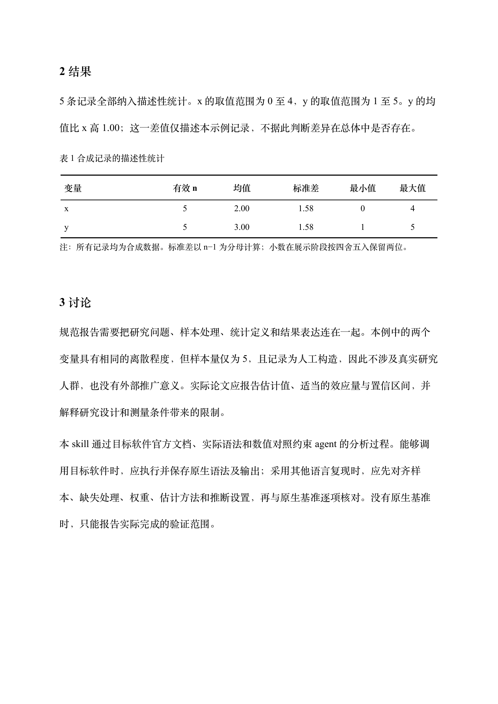

# SPSS 与 Stata 统计分析 Skill

`statistical-analysis` 指引 agent 按指定的 SPSS／Stata 版本与设置开展可复现分析，核对公式、样本、估计与推断方法，最后输出论文格式的 Word、分析代码和验证记录。

这是分析指南、验证协议和报告工具。方法导航包含 **38 类研究任务**，按需查阅目标版本的官方手册；没有把这些方法全部实现成独立统计引擎，也没有完成 SPSS／Stata 全部算法的原生对照验证。

## 直接下载和体验

- [下载完整 Skill 安装包](https://github.com/mggg83336-bit/statistical-analysis-skill/raw/refs/heads/main/downloads/statistical-analysis.zip)
- [下载论文格式 Word 示例](https://github.com/mggg83336-bit/statistical-analysis-skill/raw/refs/heads/main/examples/paper-example.docx)
- [查看示例数值与验收记录](examples/paper-example.traceability.json)

下面是实际生成的 Word 页面，使用五行合成数据，展示描述统计与三线表。



## 能做什么

- 根据研究设计选择方法，核对缺失值、编码、权重、配对、聚类、面板及时间结构。
- 导航描述统计、假设检验、回归、量表与因子模型、SEM、中介调节、混合模型、生存、面板、时间序列、因果推断、复杂抽样、插补、Meta、Bayesian 等方法族。
- 原生引擎可用时优先执行原生语法；使用其他语言复现时，对齐有效样本、参数、协方差、自由度、检验和区间算法，再逐项比较全精度结果。
- 按学术写作组织方法与结果，生成三线表和可编辑 `.docx`，并保留数值追溯文件。学校或期刊模板优先于默认格式。

## 在 agent 中使用

可以将本仓库地址直接交给支持安装技能的 agent：

```text
请从 https://github.com/mggg83336-bit/statistical-analysis-skill 安装 statistical-analysis 技能。
```


将本仓库的内容放入 `statistical-analysis` 技能目录；Codex 的默认用户技能位置为 `~/.codex/skills/statistical-analysis`，设置了 `CODEX_HOME` 时使用对应的 `skills/statistical-analysis`。目录中应直接包含 [SKILL.md](SKILL.md)。

提供数据、变量说明、研究问题和目标软件版本；有论文模板时一并提供。例如：

```text
请用 $statistical-analysis 分析我提供的数据。
以我指定的 SPSS 或 Stata 版本和分析设置为目标，说明样本与缺失值处理，
输出论文格式 Word，并附分析代码、全精度结果及原生对照记录。
没有原生基准的分析请明确标注验证状态。
```

## 运行随附工具

需要 Python 3.9 或以上版本。引擎探测、结果比对和合成数据描述统计只使用标准库；Word 构建器使用 `python-docx`，当前示例在 `python-docx 1.2.0` 下验证。Codex 文档工作流优先使用其配套运行时。

在仓库根目录运行：

```bash
# 只读检查常见引擎路径，不启动商业软件或核验许可证
python scripts/probe_engines.py

# 复算随附的五行合成数据
python scripts/demo_descriptives.py assets/demo-data.csv

# 检查结果比对工具的行为
python -m unittest discover -s scripts -p 'test_*.py'
```

在需要生成 Word 的 Python 环境中安装报告依赖，然后验证并生成示例：

```bash
python -m pip install python-docx==1.2.0
python scripts/build_report.py assets/report-spec.example.json --validate-only
python scripts/build_report.py assets/report-spec.example.json --output example-output/论文格式示例.docx
```

构建器同时生成 `.traceability.json`，保留输入规格、全精度表格值和文件校验信息。它不计算统计量，也不认证分析正确性；正式交付前仍需渲染并逐页检查版式。

## 怎么理解结果一致

| 状态 | 含义 |
| --- | --- |
| `NATIVE_EXECUTED` | 实际执行了指定原生软件与语法，并保留输出 |
| `VERIFIED_MATCH` | 本次分析与可追溯的目标原生基准，在相同设置及预定容差下逐项对照通过 |
| `REIMPLEMENTED_UNVERIFIED` | 完成了复现及相应检查，但尚未通过目标原生基准验证 |
| `BLOCKED` | 此分析缺少可靠执行所需的数据、定义、模块或环境 |

“一致”限于记录的版本、样本、过程、选项、字段和容差。只设置同一随机种子、只比较四舍五入后的输出，或只通过工具单元测试，都不能证明所有方法与原生软件一致。原生计算仍需相应软件、模块和可用运行环境。

## 文档与示例

- [Skill 主入口](SKILL.md)
- [38 类方法导航](references/methods.md)
- [公式与软件差异](references/formulas.md)
- [分析合同与复现流程](references/workflow.md)
- [原生引擎接入](references/backends.md)
- [全精度结果比对格式](references/comparison.md)
- [论文 Word 格式与构建器规格](references/paper.md)
- [可直接运行的报告输入](assets/report-spec.example.json)

随附数据全部为明确标识的合成示例。`assets/native-smoke.do` 与 `assets/native-smoke.sps` 为待在目标原生环境执行的语法小例，不能视为已生成的原生基准。

交付检查日期为 2026-11-01：28 项结果比对工具测试通过，合成描述统计经过解析定义独立核对；已生成的论文 Word 示例共 3 页并完成逐页排版检查。这些检查不构成 SPSS／Stata 全量算法认证。
